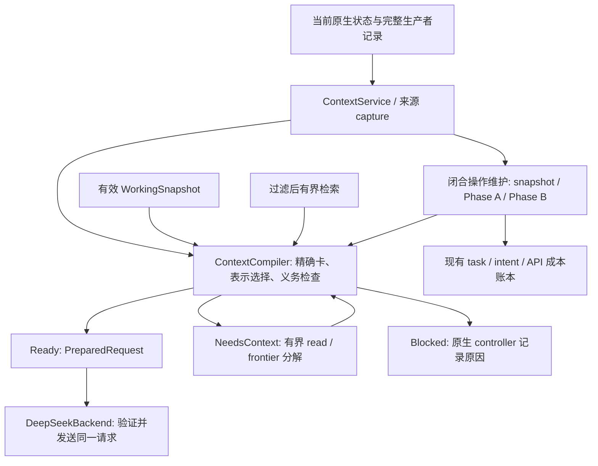

# EEGagent context 与 memory 协议

本次实现依据 `react-agent/docs/EEGagent-context-fix-codex-prompt.txt`，覆盖 M1–M5。它保护最终模型输入，并实现增量工作状态及长期经验处理。训练、审批、筛查、确认、科学证据与 artifact read 的原生 gate 保持独立。

## 调用链与职责

主要实现位于 `react-agent/src/react_agent/eeg_research/agentic/context/`：

| 模块 | 职责 |
| --- | --- |
| `types.py`, `sources.py` | 版本化来源、表示、读请求、结果类型；完整来源 hash 与 campaign 内 registry |
| `representations.py` | typed 精确卡、局部内容、引用去重及 pointer 闭包 |
| `role_policy.py`, `budget.py`, `compiler.py` | 角色义务、schema 注释精简、确定性 packing、最终 render/measure |
| `service.py`, `recovery.py` | 原生状态、闭合来源、镜像绑定、维护、有限 read/decompose 控制闭环 |
| `snapshot.py`, `persistence.py`, `maintenance.py` | ResearchDelta、section coverage、immutable draft、CAS/lease/退避 |
| `long_memory.py`, `retrieval.py` | episode 提取、增量 lesson/skill 整合、MiniLM 查询及显式分块 |
| `calibration.py` | 根据相同 role/model/mode 的已知 usage 保守提高 token 估计 |
| `native_recovery.py` | 校验并复用完成 proposal，恢复已确认且保存的回复，避免重启重复付费 |

`llm.py` 是原生计账适配器；共享 `fmri/llm/deepseek.py` 验证 PreparedRequest。fMRI 默认调用保持兼容；EEG 实例显式开启 prepared 输入要求。

## 来源、表示与读取

完整原文是事实源。来源 capture 保存 campaign、稳定 producer/event 身份、revision、完整 hash、visibility、依赖及可分页 payload。禁止的数据字段在 capture、摘要和检索前拒绝或过滤，不能靠缺少 scope 绕过保护。

四种状态分别记录：来源是否仍有效，是否适用于当前任务，本次表示保真程度，以及实际交付/读取范围。表示支持 FULL、FACT_CARD、PARTIAL、SUMMARY、REF_ONLY。科学指标、成本、阈值、时间戳和身份从原结构精确搬运；全 observation 的递归浮点舍入已移除。

引用保留真实可读 registry handle。`context://` 是 context delivery 的来源，不能满足 development artifact read receipt。读请求绑定完整 hash、范围和预算；来源变化返回 stale。最终 JSON pointer 在表示选择后验证闭包与无环，不自动展开引用。

历史交付选择不会删除原记录。当前/待决策比较保留适用的精确卡；不活跃历史可以交付有界导航。pending/active 不被宣称闭合或已覆盖。未知且可能必要的字段不能静默省略；无法在有限读取中分类时明确 Blocked。

## 预算与唯一出口

默认应用硬上限为 160000 Unicode chars；normal target 112000、high 128000、fallback 144000，repair 使用硬上限。已有角色更小的 hard cap 保留，水位按相同比例缩小。snapshot 目标 8000/上限 12000，retrieval 8000，近期原文总量 24000，单次常规读取 8000。这些共享总预算，不能相加当作额外额度。

报告分别给出 Unicode chars、UTF-8 bytes、模型 tokens、transport envelope、输出预留和 provider 策略。无法取得 provider tokenizer 时明确标记 estimate，并使用安全余量；当前 provider window 是可覆盖的保守本地策略，不是对未知模型的官方窗口保证。小窗口、巨大 system/schema 或必要 kernel 无法容纳时拒绝发送。

usage 校准只使用相同 role/model/mode 最近至多八次已知输入 usage，提高估计、不降低原估计。未知费用和未知 transport outcome 保留原生恢复语义。

PreparedRequest 冻结 system、user、messages、工具及 provider 参数，并绑定 request/source digest 和 sidecar。最终传输验证冻结内容与 profile 一致，不在发送时追加字段。HTTP 重试复用同一 PreparedRequest；schema repair 重新 compile，只带当前错误和受管相关回复。原始坏回复仍保存在原生请求记录中。

低水位是 packing 目标，达到 high、存在未覆盖闭合来源和足够收益时才触发语义维护。维护子请求也编译，但显式禁止再次维护，避免递归。输入不合格时不建立一个虚假的有效 plan。

## 增量工作状态与事务

WorkingSnapshot 保存有稳定 ID、来源和适用条件的 findings、engineering failures、open questions、决策理由及短 recent arc。权限、余额和精确指标每次从 native 重建。ResearchDelta 只能更新解释与问题，数值使用程序校验的 SourceFact 引用。

coverage 分开记录 processed、abstracted、delivered/read。经验证 no_signal 只能推进 processed；失败、空摘要、数字错误、伪造来源、无效草稿不推进 abstracted。一次大型操作可按 section 分批，只覆盖实际验证的部分。

已发布摘要替换对应原文，包括通过真实来源身份、科学身份和内容校验绑定的 analyses/evidence/controller 镜像。未覆盖段仍可读；不能将新摘要、旧摘要和已覆盖全文一起累积。活跃任务不按年龄 FIFO 删除。

发布顺序为：完整 source capture → 独立 immutable/fsync draft → schema/事实/hash/尺寸校验 → 检查 base revision、依赖及原生状态 → SQLite CAS 发布 snapshot 指针、coverage 与 job 状态。coverage 不先于有效 snapshot 发布。CAS 冲突、来源撤销、分支改变或资源变化拒绝旧 proposal。

维护自身有效性与对当前输入的压缩收益分别判断。当前请求收益由同一 compiler 在隔离临时 store 中预览 before/after，不推进真实 coverage。独立空闲维护仍可发布有效状态，不把“memory 已写入”当作“当前模型请求一定 Ready”。

controller 在无 live job 的已授权边界处理有限维护。proposal 可独立生成，但接入使用同一 CAS/hash 校验；当前没有新增常驻后台线程或调度服务。

## 长期经验与 MiniLM

Phase A 选择已闭合、变更的操作，使用 claim/lease、输入 digest、有限 batch、重试退避提取 EpisodeMemory 或 no_signal。运行中的训练不提前生成完成经验；工程失败与科学负结果分开。no_signal 记录处理完成，不写空 lesson。

Phase B 使用单 writer/lease 与 revision CAS，合并新增/变更/撤销和少量相关旧条目。lesson/skill 保留支持、反例、条件和验证程度；只有来源全部失效的主张退役，有其他有效支持的保留。成功提交才推进 baseline。旧 episode/lesson/skill 经兼容 adapter 渐进迁移，保留旧身份与完整 payload。

lesson 和 skill 跨现有两个 SQLite 文件发布使用 rollback journal 的 super-journal 事务；已使用 WAL 的相关文件会被明确拒绝，不伪称跨文件原子提交。处理冲突后需显式恢复兼容 journal 配置，不能覆盖旧数据。

MiniLM query 来自当前问题、动作、错误、方法/协议关键词及少量身份。真实 tokenizer 最大 256 tokens 参与验证；长内容以稳定块或短卡索引，记录与原记录的绑定，完整正文保存。candidate/recall/delivery 分别受数量和尺寸上限约束。未变 query、内容和模型版本复用向量；变化后失效，不以隐式 tokenizer 截断冒充完整语义输入。

所有新付费调用使用现有 task/intent/API 账本。全维护每 turn 最多两次、campaign 总计最多 100 次；snapshot 子系统还有独立更小上限和内部成本预留。单 digest 有持久 retry count/backoff，最多一次生成及一次机械纠正。多个阶段跨轮继续，不在一轮无界 map/reduce。

## 启用、旧 campaign 与恢复

`EEG_CONTEXT_PROTOCOL=enforce` 是默认。`shadow` 保留编译后的唯一发送路径并记录大小比较；两种模式都不允许超限 FULL 回退。其他值报 policy missing。

新 campaign 第一次调用创建兼容 context 表及来源 registry。旧 campaign 没有 snapshot 时 bootstrap，不需要改写历史科学记录。旧任务缓存还要匹配 context policy/render/tokenizer、预算、prompt 和 snapshot revision；已冻结的原生任务内不启动改变其身份的同步维护。

新增存储包括 `context_sources.sqlite`、`context_sources/raw/`、现有 `memory.sqlite` 的 `context_*`/pipeline 表及 `semantic_memory.sqlite` 的索引/缓存扩展。完整 coverage、request BudgetReport/DeliveryManifest 和 draft 在 sidecar/DB 中，模型只收到有界视图。不要为省上下文删除原科学证据。

restart 从 SQLite pointer/baseline、native ledger 和有效 lease 恢复。未发布 draft 不代表已覆盖；到期 lease 可重领；重复提交幂等；不明确的 API 结果继续走原生未知费用 barrier。当前真实 CAM 未被本次离线验收改写或重启。

维护的调度 turn 与内容版本分开：新 turn 不会让相同付费 proposal 自动失效。已保存回复需要校验完整依赖、task/input/config 身份、冻结请求 digest 和请求/回复 hash；pending 回复重新做 object 校验后仍须通过相应 publication validator。已注册 artifact 可原样采用，未注册的恢复写入独立文件；不重写历史 receipt。未知 outcome 或被篡改的回复不能被当作成功恢复。

## 公开参考与验证边界

本实现借鉴固定提交的 [Google ADK compaction](https://github.com/google/adk-python/blob/a334bacaae1ec0e116c74eb275fb3128ee5f913b/src/google/adk/apps/compaction.py)、[Gemini snapshot generator](https://github.com/google-gemini/gemini-cli/blob/9b6e0265d16bbd29ca51e33c9e0c01dc4cec5e83/packages/core/src/context/utils/snapshotGenerator.ts)、[Codex memories](https://github.com/openai/codex/blob/bf4ca52b61686398aafb6f4467da4202b6bdec53/codex-rs/memories/README.md) 和 [Claude Code memory 文档](https://code.claude.com/docs/en/memory) 的公开行为。下载来源及 hash 记录在 `react-agent/version/context_fix_20261013/references/manifest.json`。这些资料不能证明任何未公开服务端算法。

离线验收使用 native backend 的 mock HTTP transport、临时 campaign/SQLite/registry 和真实离线 CPU MiniLM。mock delta 证明状态机、输入与事务机制，不证明真实 LLM 摘要质量。真实 API、GPU 训练及线上 CAM 未在本次改造中验证。具体结果、成本和剩余限制见 `context-memory-validation-20261013.md`；旧规则映射见 `react-agent/version/context_fix_20261013/prompt_rule_mapping.json`。
